<!--
  VENOM / PROFILE README
  Design system: Obsidian · Electric cyan · Signal violet
  Keep this page focused on real work, useful links, and maintainable visuals.
-->

 

  

**BACKEND ENGINEERING · API SYSTEMS · INFRASTRUCTURE**

*I build practical software, tune the systems behind it, and make services feel effortless.*

---

## `01` / The work

I’m **Venom** — a developer interested in the engineering behind reliable digital products: the APIs that connect them, the servers that run them, and the automation that keeps them moving.

<table>
  <tr>
    <td width="50%" valign="top">
      <strong>⌘ &nbsp; Backend & APIs</strong> 
      Designing clear service boundaries, practical REST APIs, and maintainable server-side code.
    </td>
    <td width="50%" valign="top">
      <strong>◈ &nbsp; Infrastructure</strong> 
      Deployments, Linux/VPS administration, reverse proxies, routing, and service reliability.
    </td>
  </tr>
  <tr>
    <td width="50%" valign="top">
      <strong>⟳ &nbsp; Automation</strong> 
      Turning repeatable manual work into dependable scripts and CI workflows.
    </td>
    <td width="50%" valign="top">
      <strong>⌁ &nbsp; Performance</strong> 
      Finding bottlenecks, simplifying request paths, and improving the details that add up.
    </td>
  </tr>
</table>

## `02` / Selected direction

I’m especially interested in projects where **backend logic, real-time interactions, and production infrastructure** meet. Browse the repositories for current experiments and shipped work.

## `03` / Tools I reach for

**LANGUAGES**

**SERVICES & DATA**

**INFRASTRUCTURE & WORKFLOW**

## `04` / GitHub activity

Stats and activity cards are provided by third-party services and may occasionally be unavailable or rate-limited.

## `05` / Outside the code

<a href="https://instagram.com/Venom_owners">Instagram</a> ·
<a href="https://x.com/Tomatofist">X</a> ·
<a href="https://facebook.com/venomowners">Facebook</a>

---

**Build with intent. Ship with care. Keep improving.**

Designed as a lightweight, GitHub-native profile — no custom website required.

