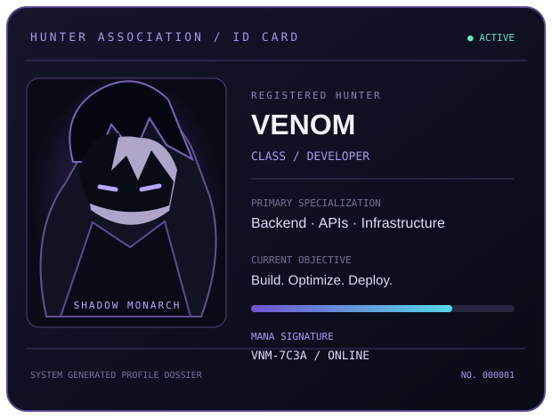
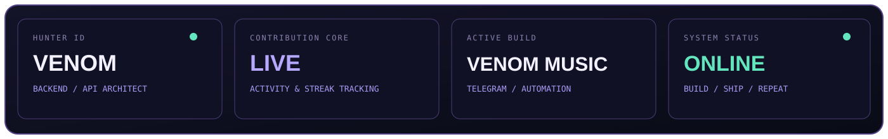

 <!-- VISITOR_COUNT_BADGE -->

---

## 01 / HUNTER DOSSIER

# VENOM

**Backend Engineer · API Architect**

I build backend systems, APIs and infrastructure designed to stay online. My work revolves around reliable services, proxy routing, server optimization and practical automation.

- **Current quest:** API development and proxy route optimization
- **Guild:** Backend systems, server engineering and open source
- **Learning:** Deployment patterns and server-side architecture
- **Ask me about:** VPS, REST APIs, proxy networks and automation
- **Passive skill:** Production-ready code — hosting is already handled.

---

## 02 / ACTIVE QUEST — FEATURED PROJECT

**[VENOM MUSIC](https://github.com/venombolteop/VenomMusic)**

Telegram music bot · Playback controls · Interactive panels · Chat-first UX

[Explore all repositories](https://github.com/venombolteop?tab=repositories)

---

## 03 / SYSTEM TERMINAL — DEPLOYMENT LOG

### Guild network

- [Telegram channel — @TomatoFist](https://t.me/TomatoFist)
- [Telegram group — @Venom_chatting](https://t.me/Venom_chatting)
- [Direct contact — @K_4ip](https://t.me/K_4ip)

### Find the hunter

---

## 04 / THE SHADOW ARSENAL

<b>▸ FULL TECHNOLOGY INVENTORY — all tools and platforms</b>

**LANGUAGES & FRAMEWORKS**

      

**CLOUD & HOSTING**

           

**BACKEND & SERVERS**

       

**DATABASES**

     

**FRONTEND & TOOLS**

      

**DEVOPS & AUTOMATION**

         

**NETWORKING & SECURITY**

    

**DATA / ML**

    

**DESIGN & GAME DEVELOPMENT**

       

---

## 05 / HUNTER STATUS — GITHUB ANALYTICS

---

## 06 / AWAKENING METRICS

---

## 07 / MANA CORE — 3D CONTRIBUTION REALM

---

## 08 / SHADOW ARMY — CONTRIBUTION SNAKE

<!--START_SECTION:snake-->

<!--END_SECTION:snake-->

---

## 09 / GUILD TAVERN — RANDOM DEVELOPER JOKE

---

## 10 / MONARCH'S DOCTRINE — RANDOM DEVELOPER QUOTE

---

## 11 / SIDE QUEST — MINI GAME

**Try to catch me!** Open the interactive 2048-style game.

---

## 12 / SUPPORT THE GUILD

---

<b>⚙️ SYSTEM ARCHITECTURE — PROFILE AUTOMATION & SETUP</b>

This profile uses GitHub Actions to refresh generated visualisations and repository traffic data:

- **[visitor-counter.yml](.github/workflows/visitor-counter.yml)** — updates the cumulative repository-view counter using GitHub traffic data; every 6 hours and manual.
- **[profile-3d.yml](.github/workflows/profile-3d.yml)** — generates the 3D contribution graph; daily and manual.
- **[metrics.yml](.github/workflows/metrics.yml)** — generates contribution, language and code metrics through [lowlighter/metrics](https://github.com/lowlighter/metrics); daily and manual.
- **[snake.yml](.github/workflows/snake.yml)** — generates the contribution snake and publishes it to the `output` branch; every 6 hours and on manual trigger.

The profile-view badge is provided by [visitor-badge.laobi.icu](https://visitor-badge.laobi.icu). External counters may be affected by caching and image requests.

The hero, dossier, arsenal board, status board, terminal and dividers are self-hosted SVGs in [assets/](assets/).

> The 3D graph appears after its workflow has run at least once. You can trigger it manually from the Actions tab.

<b>🔐 Include private contributions in the metrics card (optional)</b>

The default `GITHUB_TOKEN` can only see public data. To include private contribution totals without exposing repository names or details:

1. Go to GitHub → Settings → Developer settings → Personal access tokens → Tokens (classic).
2. Generate a token with the `repo` scope and copy it.
3. In this repository, open Settings → Secrets and variables → Actions → New repository secret.
   - **Name:** `METRICS_TOKEN`
   - **Value:** your token
4. Run the GitHub Metrics workflow once from the Actions tab.

The token is stored as an encrypted GitHub secret and is never included in this README. If omitted, metrics use public data only.

「 ARISE 」 — BUILT WITH PRODUCTION-READY CODE, BECAUSE I ALREADY OWN THE HOSTING.

